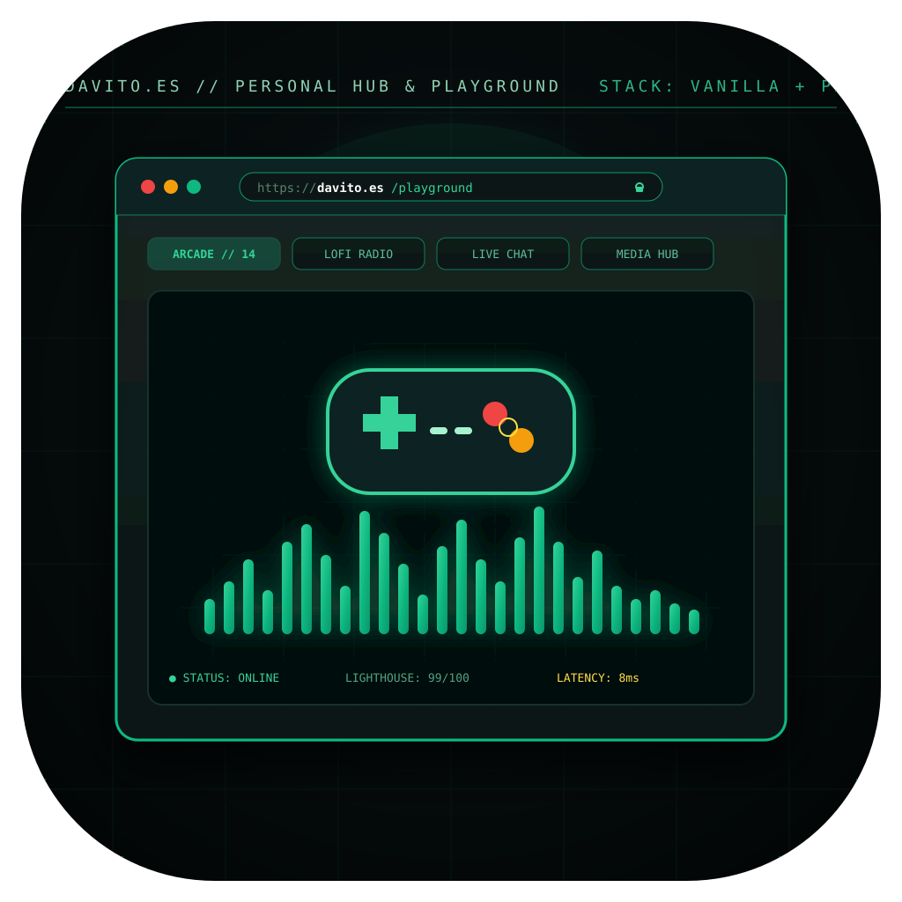
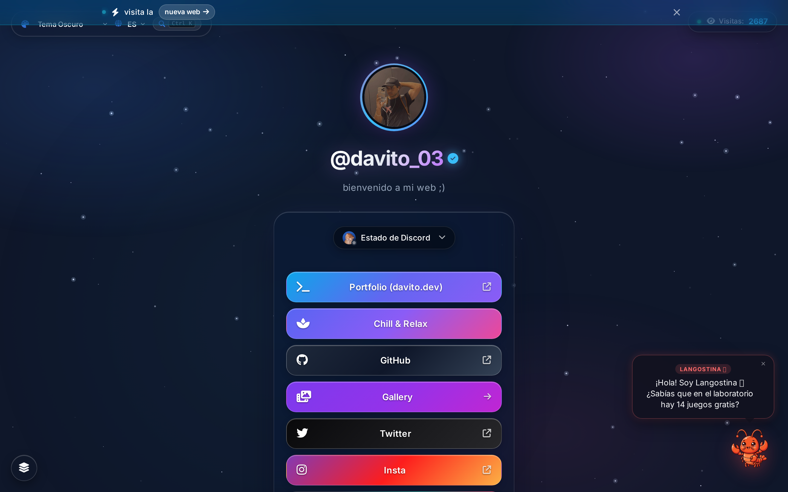
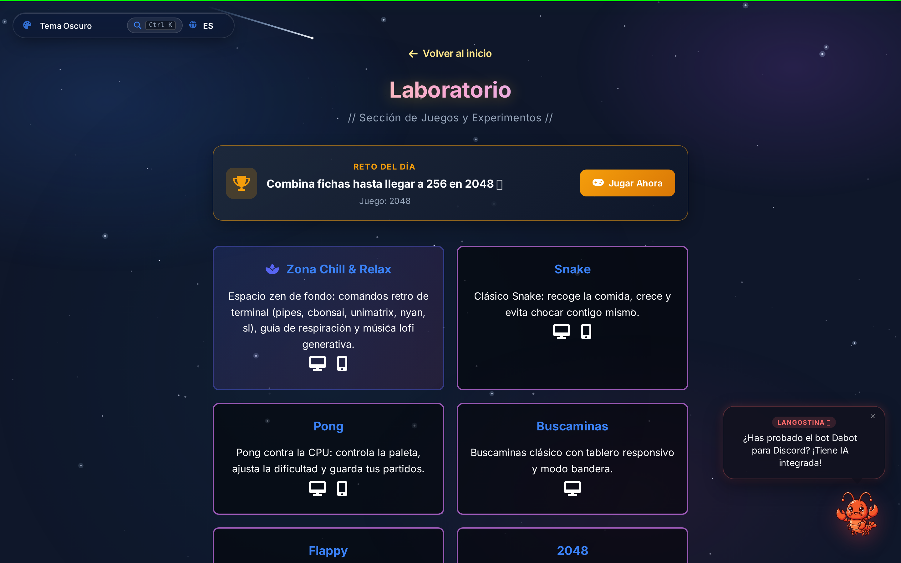
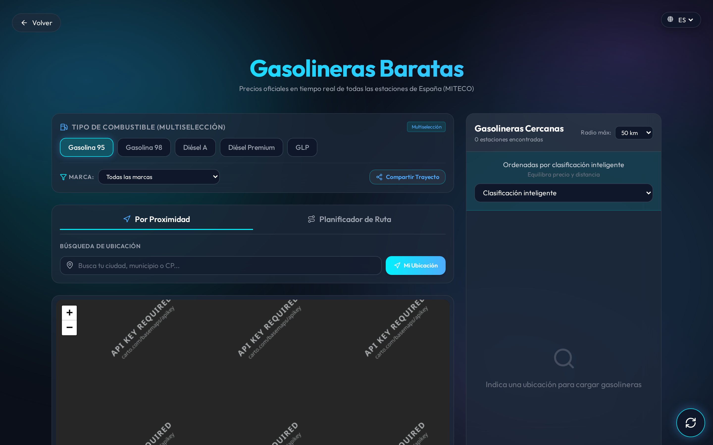

<p align="center">
  
</p>

<h1 align="center">davito.es</h1>

<p align="center">
  Hub personal, laboratorio de videojuegos en Canvas 2D nativo y utilidades web.<br>
  Construido a mano en HTML5 semántico, CSS3 moderno y Vanilla JS, respaldado por microservicios en PHP 8.3 FPM y Nginx en mi propio servidor.
</p>

<p align="center">
  <a href="https://davito.es">Sitio web</a>
  ·
  <a href="https://davito.es/pages/laboratorio.html">Laboratorio de Juegos</a>
  ·
  <a href="https://davito.es/gasolineras">Gasolineras</a>
  ·
  <a href="https://github.com/davito-03">@davito-03</a>
</p>

<p align="center">
  
  
  
  
  
</p>

---

<p align="center">
  
</p>

## Qué incluye la web

- **Hub personal interactivo**: con reproductor de música lofi en streaming, personalización visual (temas Oscuro, Cyberpunk, Matrix y Claro), chat en directo y libro de visitas con rate-limiting.
- **Laboratorio de videojuegos (14 juegos clásicos)**: programados desde cero usando la API nativa de Canvas 2D sin depender de motores pesados ni frameworks externos.
- **Gasolineras España**: comparador y radar en tiempo real que consume los datos abiertos oficiales del Ministerio para la Transición Ecológica (MITECO) y los proyecta sobre mapas interactivos Leaflet con clustering de alto rendimiento.
- **Microservicios en PHP 8.3**: endpoints ligeros protegidos con rate-limiting en memoria y moderación para el chat, contador de visitas y consultas.

---

## 🎮 Laboratorio de Videojuegos (Canvas 2D)

<p align="center">
  
</p>

El laboratorio es mi banco de pruebas para algoritmos clásicos, bucles de juego `requestAnimationFrame` con delta-time a 60/120 FPS y matemáticas vectoriales 2D. 

Incluye implementaciones completas de:
- **Tetris**: rotación de piezas SRS, sistema de puntuación clásico y caída rápida.
- **Space Invaders**: oleadas alienígenas, bunkers destructibles y proyectiles.
- **Asteroids**: física de inercia y rozamiento en espacio toroidal con disparo láser.
- **Snake**, **2048**, **Buscaminas**, **Conecta 4**, **Pong**, **Flappy Bird**, **RPG por turnos**, entre otros.

---

## ⛽ Gasolineras España (MITECO Open Data)

<p align="center">
  
</p>

- Conexión directa vía proxy Nginx con la API REST de `ServiciosRESTCarburantes` del Gobierno de España.
- Proyección de más de 11.000 estaciones de servicio con filtros instantáneos por tipo de carburante (Gasolina 95, 98, Diésel, Diésel Plus, GLP y GNC) y ordenación por precio más económico.

---

## Cómo levantarlo en local

Para trastear con el frontend estático:

```bash
# Servidor local rápido para las páginas estáticas
python3 -m http.server 8080
```

> **Nota técnica:** Los endpoints `/api/*.php` (chat, libro de visitas) requieren PHP-FPM 8.3 configurado tras un servidor web como Nginx o Apache. En el VPS corre en un contenedor Docker `php:8.3-fpm` aislado tras Nginx.

---

## Licencia

Distribuido bajo licencia MIT. Consulta [LICENSE](LICENSE) para más detalles.
